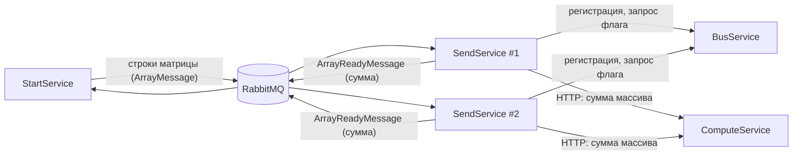

# MassTransit Pet

Эксперимент по распределённым вычислениям на .NET 6: сумма элементов случайной матрицы считается несколькими
экземплярами сервиса, которые общаются через RabbitMQ (MassTransit) и HTTP (Refit) и по очереди получают право
на обработку — «флаг» (распределённое взаимное исключение).

**Стек:** C# · .NET 6 · MassTransit 8 · RabbitMQ · Refit · ASP.NET Web API

## Как это работает

| Сервис | Роль |
| --- | --- |
| `StartService` | генерирует матрицу `Length × Length` (по умолчанию 100), транспонирует её и публикует строки; складывает пришедшие суммы и замеряет время |
| `SendService` | рабочий экземпляр (запускается в нескольких копиях на разных портах): регистрируется в шине, получает строки, а при наличии «флага» отправляет их на подсчёт и публикует результат |
| `BusService` | консольный координатор очередей регистрации и запросов флага |
| `ComputeService` | HTTP-сервис подсчёта суммы массива (`POST /Compute/GetArraySum`) |
| `DataContracts` | общие сообщения шины и Refit-интерфейс `IComputeApi` |

## Запуск

1. RabbitMQ: `docker run -p 15672:15672 -p 5672:5672 masstransit/rabbitmq`
2. Запустить `ComputeService`, `BusService` и несколько экземпляров `SendService` на разных портах
   (`dotnet run --urls http://localhost:<порт>`).
3. Запустить `StartService` — он разошлёт матрицу и выведет итоговую сумму и время.

Размер матрицы — параметр `Length` в `StartService/StartService.Main/appsettings.json`.
